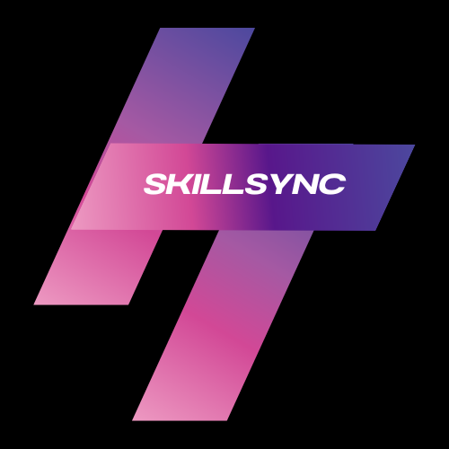
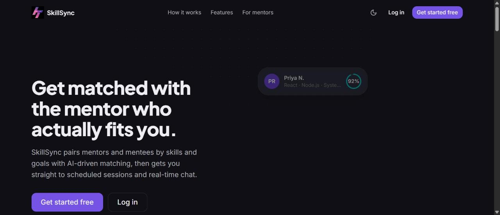
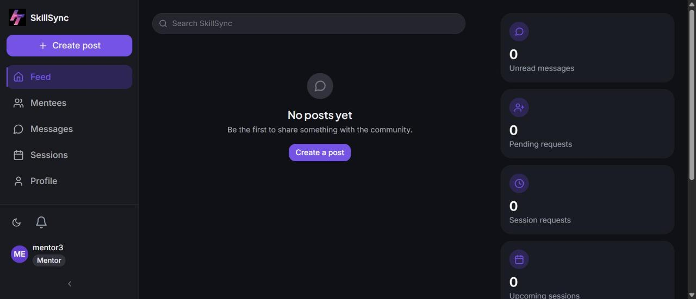
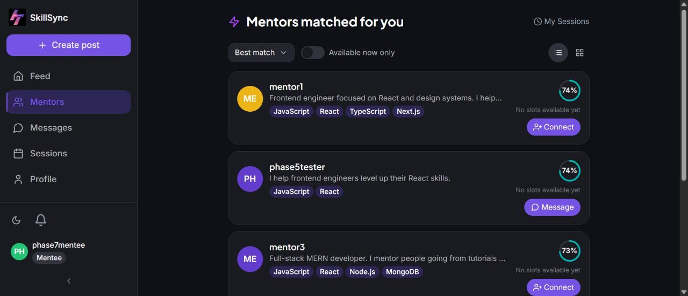

<div align="center">



# SkillSync

**Get matched with the mentor who actually fits you.**

SkillSync pairs mentors and mentees by skills and goals using AI-driven matching, then gets them straight to scheduled sessions and real-time chat.

[](https://react.dev)
[](https://expressjs.com)
[](https://www.mongodb.com/atlas)
[](https://socket.io)
[](https://tailwindcss.com)
[](https://vitejs.dev)

</div>

---

## ✨ What it does

SkillSync is a full-stack mentor/mentee matching platform built end-to-end: signup and onboarding, AI-powered recommendations, a social feed, session booking with availability management, ratings & reviews, and real-time chat — all behind a custom light/dark design system.

| | |
|---|---|
| 🧠 **AI-driven matching** | Mentors and mentees are ranked by cosine similarity over Gemini text embeddings built from each person's skills, bio, and experience — not keyword search. |
| 💬 **Real-time chat** | Socket.io-powered messaging with typing indicators, online presence, read receipts, attachments (images, PDFs, voice notes), and connection requests. |
| 📅 **Sessions & availability** | Mentors publish open time slots; mentees book a session, the mentor confirms or declines, and both sides can rate the session afterward. |
| 📰 **Social feed** | Posts, comments, nested replies, likes, and saved posts — a lightweight feed to keep the community active between sessions. |
| 🔐 **Flexible auth** | Email/password or "Sign in with Google," with a guided onboarding flow that collects the profile data the matching engine needs. |
| 🎨 **Themeable UI** | A token-based design system (Radix UI primitives + Tailwind v4) with full light/dark theming, built from scratch across an 8-phase redesign. |

## 📸 Screenshots

<table>
<tr>
<td width="33%"><p align="center"><sub>Landing page</sub></p></td>
<td width="33%"><p align="center"><sub>Feed &amp; dashboard</sub></p></td>
<td width="33%"><p align="center"><sub>AI mentor matching</sub></p></td>
</tr>
</table>

## 🏗️ Architecture

A MERN stack split into two independent apps with no shared package boundary:

```
SkillSync/
├── client/   Vite + React 18 SPA — Tailwind CSS v4, React Router v7, Radix UI, Socket.io-client
└── server/   Express API + Socket.io real-time layer — Mongoose/MongoDB, JWT auth, Cloudinary uploads
```

**Client**
- Design system of ~30 reusable primitives (`Button`, `Dialog`, `Tabs`, `Select`, `ConfirmDialog`, …) built on Radix UI, styled through Tailwind v4 CSS-variable tokens that drive both light and dark themes
- React Router v7 with a shared app-shell layout, responsive mobile nav, and route-level code organization by feature (auth, onboarding, feed, people, chat, sessions, profile)
- `framer-motion` for page transitions and micro-interactions, with a global `prefers-reduced-motion` opt-out

**Server**
- REST API (`/api/auth`, `/api/posts`, `/api/profile`, `/api/chats`, `/api/mentors`, `/api/sessions`, `/api/reviews`, `/api/dashboard`) behind JWT middleware
- Socket.io layer for live chat, typing status, presence, connection requests, and session-request events, authenticated on the same JWT
- `services/embedding.service.js` calls Google's `gemini-embedding-001` model directly to build each user's match vector; `utils/cosineSimilarity.js` ranks candidates
- File uploads (avatars, resumes, post images, chat attachments) stream straight to Cloudinary rather than local disk

## 🧰 Tech stack

| Layer | Technologies |
|---|---|
| Frontend | React 18, Vite, React Router v7, Tailwind CSS v4, Radix UI, framer-motion, Axios, Socket.io-client, sonner (toasts) |
| Backend | Node.js, Express, Socket.io, Mongoose/MongoDB, JSON Web Tokens, bcrypt, Multer |
| AI / Matching | Google Gemini (`gemini-embedding-001`) text embeddings, cosine similarity |
| Auth | Email/password + Google OAuth (`@react-oauth/google`, `google-auth-library`) |
| Storage | Cloudinary (avatars, resumes, post images, chat attachments) |
| Hosting | Vercel (client), Render (server), MongoDB Atlas (database) |

## 🚀 Getting started

### Prerequisites
- Node.js 18+
- A MongoDB Atlas cluster (or local MongoDB)
- A free [Google AI Studio](https://aistudio.google.com) API key (for embeddings)
- A free [Cloudinary](https://cloudinary.com) account (for file uploads)
- A [Google Cloud](https://console.cloud.google.com) OAuth client ID (optional, for "Sign in with Google")

### 1. Clone and install
```bash
git clone https://github.com/reneeshaP/SkillSync.git
cd SkillSync

cd server && npm install
cd ../client && npm install
```

### 2. Configure environment variables

**`server/.env`** (copy from `server/.env.example`):
```env
PORT=8000
MONGO_URI=your-mongodb-connection-string
JWT_SECRET=your-random-secret
GEMINI_API_KEY=your-gemini-api-key
GOOGLE_CLIENT_ID=your-google-oauth-client-id
CLIENT_URL=                      # deployed client origin(s), comma-separated — leave blank for local dev
CLOUDINARY_CLOUD_NAME=your-cloud-name
CLOUDINARY_API_KEY=your-api-key
CLOUDINARY_API_SECRET=your-api-secret
```

**`client/.env`**:
```env
VITE_API_URL=http://localhost:8000/api
VITE_GOOGLE_CLIENT_ID=your-google-oauth-client-id
```

### 3. Run it
```bash
# Terminal 1
cd server && npm run dev

# Terminal 2
cd client && npm run dev
```

The client runs at `http://localhost:5173`, the API at `http://localhost:8000`.

## ☁️ Deployment

This project is set up to deploy as two independently-hosted pieces, with MongoDB Atlas and Cloudinary as managed services behind them:

- **Client** → [Vercel](https://vercel.com) (zero-config Vite detection, SPA rewrite included via `client/vercel.json`)
- **Server** → [Render](https://render.com) (free web service — supports the persistent WebSocket connections Socket.io needs)
- **Database** → [MongoDB Atlas](https://www.mongodb.com/atlas)
- **File storage** → [Cloudinary](https://cloudinary.com)

## 📂 Project structure

```
client/src/
├── Pages/              Route-level pages (Landing, Feed, Chat, Sessions, Profile, …)
├── components/
│   ├── ui/              Design-system primitives (Button, Dialog, Tabs, Toast, …)
│   ├── layout/           App shell, sidebar, mobile nav
│   ├── profile/           Profile page split into focused subcomponents
│   └── onboarding/, auth/, landing/   Feature-specific component groups
├── contexts/            Auth, Socket, Theme, Dashboard-stats providers
├── services/             API clients (one per resource)
└── lib/                Shared helpers (env config, date formatting, avatar URLs)

server/
├── routes/              REST endpoints, one file per resource
├── models/               Mongoose schemas
├── controllers/          Auth/profile business logic
├── middleware/           JWT auth guard
├── services/              Gemini embedding generation
└── socket.js             Socket.io event handlers
```

---

<div align="center">
<sub>Built as an end-to-end portfolio project — MERN stack, AI-powered matching, real-time chat, and a hand-built design system.</sub>
</div>
